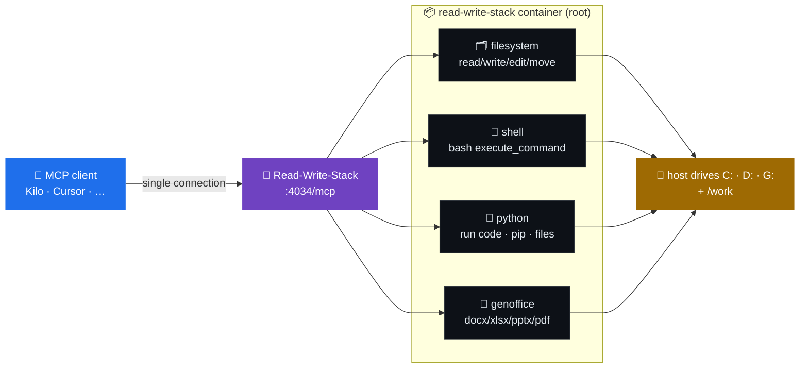

<div align="center">

# 📂 Read-Write-Stack MCP

### 🔓 **One MCP server. Full read/write on your machine. One container.** 🔓

**45 tools · filesystem + shell + Python + GenOffice · root access**

[](#)
[](#-tool-coverage)
[](#-root-access)
[](#-quick-start)
[](#-license)

<sub>Point your client at <b>one</b> endpoint — <code>http://127.0.0.1:4034/mcp</code> — and read, write, run and edit everything.</sub>

</div>

---

## 🚀 What is this?

```text
┌────────────────────────────────────────────────────────────────────────┐
│   Instead of wiring FOUR MCP servers into your client…                  │
│     a filesystem server · a shell server · a python server · genoffice  │
│                                                                        │
│   Connect ONE.  📂 Read-Write-Stack merges them behind one endpoint.    │
└────────────────────────────────────────────────────────────────────────┘
```

The container runs every upstream on `127.0.0.1`, the **aggregator** exposes
their merged tools, and each call is routed to the right server. It runs as
**root** and mounts your drives, so an agent can read/write anywhere. 🔓

---

## 🧭 Architecture



---

## 🧰 Tool coverage — `45 tools`

| | Upstream | Emoji | Adds | Tools |
|---|---|---|---|---|
| 🗂️ | **filesystem** (official MCP) | files | read/write/edit/move/copy/search, dir tree, allowed-dirs | `16` |
| 🐚 | **shell** (`shell-mcp-server`) | shell | `execute_command` (bash), timeout control | `1` |
| 🐍 | **python** (`mcp-python-interpreter`) | python | run code/file, pip install, read/write files, sessions | `10` |
| 📄 | **genoffice** (`mcp-genoffice`) | documents | docx/xlsx/pptx/pdf **read** + byte-preserving edit/create | `15` |
| 🧩 | **local** | helpers | `web_stack_status` · `web_stack_refresh` · `web_stack_rotation` | `3` |

> 💡 Collisions are auto-namespaced: `read_file` / `write_file` / `list_directory`
> exist in both filesystem and python, so they appear as **`fs__*`** and **`python__*`**.

---

## 🔓 Root access

The container runs as **`root`** and mounts your drives **read-write**:

| Layer | Setting |
|---|---|
| 🗂️ filesystem | allowed directory = `/` (everything) |
| 🐍 python | `MCP_ALLOW_SYSTEM_ACCESS=1` (path checks lifted) |
| 🐚 shell | allowed `/` · runs as root |
| 📄 genoffice | no path restriction |
| 💾 mounts | `C:\` · `D:\` · `G:\` + `/work`, all `rw` |

> ⚠️ This is **full-machine read/write** by design. Only connect trusted agents.

---

## ⚡ Quick start

```bash
git clone https://github.com/Akshat-530/read-write-stack-mcp.git
cd read-write-stack-mcp

docker build -t read-write-stack:allinone .
docker run -d --name read-write-stack \
  -p 127.0.0.1:4034:4034 \
  -v "C:\:/host/c" -v "D:\:/host/d" \
  read-write-stack:allinone
```

Or with the published image:

```bash
docker compose -f docker-compose.example.yml up -d
```

Then connect your MCP client ➜ **`http://127.0.0.1:4034/mcp`** 🎉

---

## ⚙️ Configuration

The image is self-contained: the aggregator config is baked at
`/data/config/config.json` and `WEBSTACK_CONFIG`, `MCP_ALLOW_SYSTEM_ACCESS=1`
and `GENOFFICE_SRC` are set in the image. Override the config by mounting your own:

```bash
-v ./my-config.json:/data/config/config.json:ro
```

Per upstream you can set `include` (allowlist, `[]` = all), `exclude`, `prefix`
and `enabled`.

> Note: `web_stack_rotation` is exposed for parity with the Web-Stack but is a
> **no-op here** (this stack has no API-key rotation).

---

## 🔗 Connect your MCP client

**Claude Desktop / Cursor** (`mcpServers`):

```json
{
  "mcpServers": {
    "read-write-stack": {
      "type": "remote",
      "url": "http://127.0.0.1:4034/mcp"
    }
  }
}
```

**Kilo** (`kilo.jsonc`):

```jsonc
{
  "mcp": {
    "read-write-stack-mcp": {
      "type": "remote",
      "url": "http://127.0.0.1:4034/mcp",
      "enabled": true,
      "timeout": 1800000
    }
  }
}
```

Reload the client → **45 tools** appear. 🎯 Sanity check: call **`web_stack_status`**.

---

## 🛠️ Operations

```bash
docker exec read-write-stack supervisorctl status   # ✅ every upstream
docker logs -f read-write-stack                     # 📜 live logs
```

Every upstream is **supervised** — auto-restarts on crash. 🩹

---

## 🩺 Troubleshooting

| 😵 Symptom | 🛠️ Fix |
|---|---|
| Docker build fails on python MCPs | they need the **MCP Python SDK 1.x** — the image pins `mcp<2` in isolated venvs |
| `shell` / `python` upstream not OK | check `supervisorctl status`; the shell MCP is launched via an async wrapper |
| genoffice tools missing | `mcp-genoffice` loads the GenOffice engine from `/opt/genoffice-src` (`GENOFFICE_SRC`) |
| A new drive not reachable | add it to the compose `volumes` |
| Want fewer/more tools | edit `config/config.example.json` (`include`/`exclude`/`enabled`) → mount at `/data/config/config.json` → restart |

---

## 📜 License

MIT — see [LICENSE](LICENSE).
Upstream MCP servers and GenOffice keep their own licenses (GenOffice engine is Apache-2.0,
loaded at runtime).

<div align="center">
<sub>Built with 📂 by <a href="https://github.com/Akshat-530">Akshat-530</a></sub>
</div>
